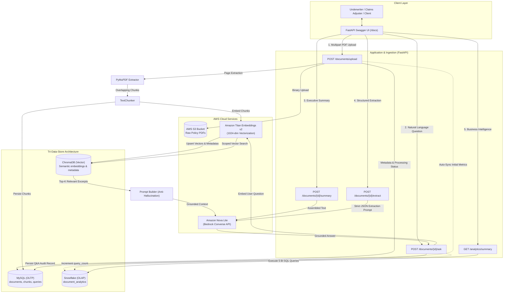

# AI Insurance Document Intelligence Assistant

[](https://www.python.org/)
[](https://fastapi.tiangolo.com/)
[](https://aws.amazon.com/bedrock/)
[](https://www.trychroma.com/)
[](https://www.snowflake.com/)
[](https://www.mysql.com/)

A enterprise-grade GenAI application designed to process complex commercial and personal insurance policies, extract page-aware clause text, index semantic embeddings, deliver grounded anti-hallucinatory question-answering with verifiable source attribution (page and chunk citations), extract structured policy terms, and stream business intelligence metrics into Snowflake.

---

## Table of Contents
1. [Project Overview](#1-project-overview)
2. [Architecture & Tri-Data-Store Model](#2-architecture--tri-data-store-model)
3. [Setup & Installation Instructions](#3-setup--installation-instructions)
4. [Environment Variable Documentation](#4-environment-variable-documentation)
5. [End-to-End Workflow Walkthrough](#5-end-to-end-workflow-walkthrough)
6. [Interactive Swagger API Documentation](#6-interactive-swagger-api-documentation)
7. [Sample Requests & Responses](#7-sample-requests--responses)
8. [Deep Dive: Retrieval-Augmented Generation (RAG)](#8-deep-dive-retrieval-augmented-generation-rag)
9. [Tri-Data-Store Architecture: MySQL vs. ChromaDB vs. Snowflake](#9-tri-data-store-architecture-mysql-vs-chromadb-vs-snowflake)
10. [Cloud Foundation: AWS S3 & Amazon Bedrock](#10-cloud-foundation-aws-s3--amazon-bedrock)
11. [Running Automated Tests & Verification Suites](#11-running-automated-tests--verification-suites)

---

## 1. Project Overview

Insurance policies, claim forms, and endorsements are dense, legally binding multi-page PDF documents. Traditional keyword searches and raw LLM prompting suffer from severe hallucination risks, inability to provide page-level citations, and high compute overhead.

The **AI Insurance Document Intelligence Assistant** solves this through a decoupled, production-ready pipeline:
- **PyMuPDF (`fitz`) Text Extraction**: Cleans and preserves exact per-page boundaries.
- **Sliding-Window Chunking**: Generates overlapping document chunks with full metadata retention.
- **Amazon Titan Text Embeddings v2**: High-dimensional semantic vectorization (1,024 dimensions).
- **ChromaDB**: Local, high-performance vector store with cosine distance indexing and strict per-document scoping.
- **Amazon Nova Lite (`amazon.nova-lite-v1:0`)**: Foundation model accessed via the boto3 Bedrock Converse API with zero-temperature deterministic grounding.
- **Tri-Data-Store Pattern**: Clear separation of operational transactional data (MySQL), vector search (ChromaDB), and business intelligence analytics (Snowflake).

---

## 2. Architecture & Tri-Data-Store Model



---

## 3. Setup & Installation Instructions

### Prerequisites
- **Python 3.12+** (tested on 3.12)
- **MySQL Server 8.0+** (running locally on port 3306 or remote)
- **AWS Account** with Amazon Bedrock model access granted for:
  - `amazon.titan-embed-text-v2:0`
  - `amazon.nova-lite-v1:0`
- **AWS CLI** configured (`aws configure`) or IAM access keys
- *(Optional)* **Snowflake Account** (if omitted, application operates automatically in offline Mock Analytics mode)

### Installation Steps

1. **Clone the repository and enter the directory**:
   ```powershell
   cd c:\Insurance_AI
   ```

2. **Activate the virtual environment**:
   ```powershell
   .\venv\Scripts\activate
   ```

3. **Install dependencies**:
   ```powershell
   pip install -r requirements.txt
   ```

4. **Initialize MySQL Database**:
   Create the database in MySQL:
   ```sql
   CREATE DATABASE IF NOT EXISTS insurance_ai_db;
   ```

5. **Configure your `.env` file**:
   Copy the provided example file:
   ```powershell
   copy .env.example .env
   ```
   Open `.env` and configure your credentials (see [Section 4](#4-environment-variable-documentation)).

6. **Start the FastAPI Application**:
   ```powershell
   python main.py
   ```
   The application starts at `http://127.0.0.1:8000`.

7. **Explore the Swagger UI**:
   Navigate to [http://127.0.0.1:8000/docs](http://127.0.0.1:8000/docs) in your browser.

---

## 4. Environment Variable Documentation

Configure these settings in your local `.env` file. Never commit `.env` to version control.

| Environment Variable | Default Value | Description |
|---|---|---|
| **`APP_NAME`** | `"AI Insurance Document Intelligence Assistant"` | Application identifier |
| **`ENVIRONMENT`** | `"development"` | Runtime mode (`development` or `production`) |
| **`HOST`** | `"127.0.0.1"` | Host address for Uvicorn server |
| **`PORT`** | `8000` | Port for Uvicorn server |
| **`LOG_LEVEL`** | `"INFO"` | Logging verbosity (`DEBUG`, `INFO`, `WARNING`, `ERROR`) |
| **`MYSQL_HOST`** | `"localhost"` | Hostname or IP for MySQL server |
| **`MYSQL_PORT`** | `3306` | Port for MySQL database |
| **`MYSQL_USER`** | `"root"` | MySQL user |
| **`MYSQL_PASSWORD`** | `""` | MySQL user password |
| **`MYSQL_DATABASE`** | `"insurance_ai_db"` | MySQL database schema name |
| **`AWS_PROFILE`** | `"default"` | Named AWS CLI profile for credentials resolution |
| **`AWS_REGION`** | `"us-east-1"` | AWS region hosting S3 and Bedrock models |
| **`AWS_ACCESS_KEY_ID`** | `None` | IAM access key (optional if using profile or instance role) |
| **`AWS_SECRET_ACCESS_KEY`** | `None` | IAM secret key |
| **`S3_BUCKET_NAME`** | `None` | Amazon S3 bucket name for PDF binary storage |
| **`S3_PREFIX`** | `"documents"` | S3 object key directory prefix |
| **`CHUNK_SIZE`** | `1000` | Text chunk character size |
| **`CHUNK_OVERLAP`** | `200` | Overlapping characters between consecutive chunks |
| **`BEDROCK_EMBEDDING_MODEL_ID`**| `"amazon.titan-embed-text-v2:0"` | Amazon Bedrock embedding model |
| **`EMBEDDING_DIMENSION`** | `1024` | Titan embedding vector length |
| **`CHROMA_PERSIST_DIRECTORY`** | `"./data/chromadb"` | Local directory for persistent ChromaDB storage |
| **`CHROMA_COLLECTION_NAME`** | `"insurance_documents"` | ChromaDB vector collection identifier |
| **`BEDROCK_MODEL_ID`** | `"amazon.nova-lite-v1:0"` | Amazon Bedrock foundation model for GenAI |
| **`BEDROCK_MAX_TOKENS`** | `2048` | Maximum token limit for completions |
| **`BEDROCK_TEMPERATURE`** | `0.0` | Sampling temperature (`0.0` ensures deterministic output) |
| **`RAG_TOP_K`** | `5` | Default number of relevant chunks retrieved per question |
| **`SNOWFLAKE_ACCOUNT`** | `None` | Snowflake account identifier (e.g. `xy12345.us-east-1`) |
| **`SNOWFLAKE_USER`** | `None` | Snowflake service account username |
| **`SNOWFLAKE_PASSWORD`** | `None` | Snowflake password |
| **`SNOWFLAKE_WAREHOUSE`** | `"COMPUTE_WH"` | Snowflake virtual warehouse |
| **`SNOWFLAKE_DATABASE`** | `"INSURANCE_DB"` | Snowflake analytical database |
| **`SNOWFLAKE_SCHEMA`** | `"PUBLIC"` | Snowflake analytical schema |
| **`SNOWFLAKE_ROLE`** | `"ACCOUNTADMIN"` | Snowflake user role |

---

## 5. End-to-End Workflow Walkthrough

1. **Start Server**: Run `python main.py`. Database tables (`documents`, `document_chunks`, `queries`) are automatically created if they don't exist.
2. **Access Swagger**: Open `http://127.0.0.1:8000/docs`.
3. **Upload PDF**:
   - Send `POST /documents/upload` with a multipart form containing `file` (`.pdf`) and `document_type` (e.g. `"Commercial Property"`).
   - Validates file headers (`%PDF-`), uploads raw PDF to S3, records metadata in MySQL, extracts text per page using PyMuPDF, chunks text with 200-char overlap, embeds text via Titan v2, indexes into ChromaDB, and updates status to `PROCESSED`.
4. **Ask a Policy Question (RAG)**:
   - Send `POST /documents/{document_id}/ask` with `{"question": "Is flood or water damage covered?"}`.
   - Generates embedding vector for question, searches ChromaDB scoped strictly to `{document_id}`, builds grounded prompt, invokes Amazon Nova Lite, returns grounded answer with exact page citations, and saves Q&A in MySQL `queries`.
5. **Generate Summary**:
   - Send `POST /documents/{document_id}/summary`.
   - Assembles multi-page text and prompts Nova Lite for an executive narrative and key takeaway bullet points.
6. **Extract Structured Insurance JSON**:
   - Send `POST /documents/{document_id}/extract`.
   - Prompts Nova Lite with strict zero-shot anti-hallucination rules returning validated JSON (`policy_type`, `coverage`, `exclusions`, `deductible`, `important_conditions`, `risk_indicators`).
7. **Analyze Metrics in Snowflake**:
   - Send `GET /analytics/summary` to view multi-dimensional aggregations (documents by type, questions per document, risk distributions, average processing duration).

---

## 6. Interactive Swagger API Documentation

FastAPI provides automated, interactive OpenAPI documentation at `/docs` and ReDoc at `/redoc`.

| Method | Path | Summary | Description |
|---|---|---|---|
| `GET` | `/health` | Health Check | Verifies API status and database connectivity |
| `POST` | `/documents/upload` | Upload & Ingest PDF | Uploads PDF to S3, extracts text, chunks, embeds, and indexes |
| `GET` | `/documents` | List Documents | Returns paginated list of ingested documents |
| `GET` | `/documents/{id}` | Get Document Details | Retrieves document metadata and processing status |
| `POST` | `/documents/{id}/ask` | RAG Question Answering | Grounded Q&A against document with page/chunk attribution |
| `POST` | `/documents/{id}/summary`| Executive Summary | Generates summary narrative and key takeaways via Nova Lite |
| `POST` | `/documents/{id}/extract`| Structured Extraction | Extracts structured policy terms into validated JSON |
| `POST` | `/search` | Similarity Search | Semantic vector search across chunks in ChromaDB |
| `GET` | `/analytics/summary` | Snowflake Analytics | Returns 5 core business intelligence aggregations |
| `POST` | `/analytics/sync/{id}` | Sync to Snowflake | Extracts MySQL operational metrics and upserts to Snowflake |

---

## 7. Sample Requests & Responses

### 1. Document Upload (`POST /documents/upload`)
**Request**:
```http
POST /documents/upload HTTP/1.1
Content-Type: multipart/form-data; boundary=----Boundary
--Boundary
Content-Disposition: form-data; name="document_type"

Commercial Property
--Boundary
Content-Disposition: form-data; name="file"; filename="acme_property_policy.pdf"
Content-Type: application/pdf

[Binary PDF Content]
--Boundary--
```

**Response (HTTP 201 Created)**:
```json
{
  "document_id": 1,
  "file_name": "acme_property_policy.pdf",
  "document_type": "Commercial Property",
  "s3_key": "documents/20260914_120000_acme_property_policy.pdf",
  "status": "PROCESSED",
  "total_pages": 3,
  "total_chunks": 8,
  "chunks": [
    {
      "chunk_id": 101,
      "document_id": 1,
      "chunk_index": 0,
      "page_number": 1,
      "text": "POLICY DECLARATIONS - COMMERCIAL PROPERTY...",
      "file_name": "acme_property_policy.pdf",
      "document_type": "Commercial Property"
    }
  ],
  "created_at": "2026-09-14T12:00:00"
}
```

---

### 2. RAG Question Answering (`POST /documents/{document_id}/ask`)
**Request**:
```json
POST /documents/1/ask
Content-Type: application/json

{
  "question": "Is water damage covered by this policy?",
  "top_k": 3
}
```

**Response (HTTP 200 OK)**:
```json
{
  "answer": "Based on the provided policy documents (Page 2), water damage resulting from flood, surface water, waves, or sewer backup is explicitly excluded under Exclusion Section 4. However, sudden and accidental water discharge from internal plumbing fixtures is covered subject to the $5,000 standard deductible.",
  "sources": [
    {
      "file_name": "acme_property_policy.pdf",
      "page_number": 2,
      "chunk_id": 102
    },
    {
      "file_name": "acme_property_policy.pdf",
      "page_number": 1,
      "chunk_id": 101
    },
    {
      "file_name": "acme_property_policy.pdf",
      "page_number": 3,
      "chunk_id": 103
    }
  ],
  "document_id": 1,
  "query_id": 1
}
```

---

### 3. Structured Data Extraction (`POST /documents/{document_id}/extract`)
**Response (HTTP 200 OK)**:
```json
{
  "document_id": 1,
  "file_name": "acme_property_policy.pdf",
  "document_type": "Commercial Property",
  "model_id": "amazon.nova-lite-v1:0",
  "extraction": {
    "policy_type": "Commercial Property Insurance",
    "coverage": {
      "building_property": "$2,500,000",
      "business_personal_property": "$750,000",
      "business_income_extra_expense": "$300,000"
    },
    "exclusions": [
      "Flood, surface water, and sewer backup",
      "Earth movement including earthquake and landslide",
      "Normal wear and tear and gradual deterioration"
    ],
    "deductible": {
      "standard_deductible": "$5,000 per occurrence",
      "windstorm_hail_deductible": "2% of stated building value"
    },
    "important_conditions": [
      "Prompt notice of claim required within 30 days of loss occurrence",
      "Insured must protect property from further damage"
    ],
    "risk_indicators": [
      "High building property limit with percentage-based windstorm deductible",
      "Complete exclusion of flood risks requiring separate endorsement"
    ]
  }
}
```

---

### 4. Snowflake Analytics Summary (`GET /analytics/summary`)
**Response (HTTP 200 OK)**:
```json
{
  "engine": "Snowflake Live OLAP",
  "total_processed_documents": 6,
  "documents_by_type": [
    {"document_type": "Commercial Property", "doc_count": 2},
    {"document_type": "Commercial Auto", "doc_count": 1},
    {"document_type": "Cyber Liability", "doc_count": 1},
    {"document_type": "Inland Marine", "doc_count": 1},
    {"document_type": "Workers Compensation", "doc_count": 1}
  ],
  "questions_by_document": [
    {"document_id": 3, "document_type": "Workers Compensation", "query_count": 7},
    {"document_id": 1, "document_type": "Commercial Property", "query_count": 5},
    {"document_id": 2, "document_type": "Commercial Auto", "query_count": 2},
    {"document_id": 6, "document_type": "Inland Marine", "query_count": 2},
    {"document_id": 4, "document_type": "Cyber Liability", "query_count": 1}
  ],
  "risk_distribution": [
    {"risk_category": "LOW", "category_count": 2},
    {"risk_category": "MEDIUM", "category_count": 2},
    {"risk_category": "CRITICAL", "category_count": 1},
    {"risk_category": "HIGH", "category_count": 1}
  ],
  "processing_time_metrics": {
    "avg_processing_time": 1.5,
    "min_processing_time": 0.68,
    "max_processing_time": 2.4
  }
}
```

---

## 8. Deep Dive: Retrieval-Augmented Generation (RAG)

### Why RAG for Insurance Documents?
Foundation models are pre-trained on generic corpora. They do not know specific endorsements, policy terms, or deductibles for a specific insured party. Passing entire 100-page policies into an LLM context window creates high latency, high token costs, and hallucinations.

### The Pipeline Steps:
1. **Per-Page Text Extraction**: Using PyMuPDF, document text is extracted page by page. Unlike naive text dumping, page numbers (`page_number`) are captured alongside every text block.
2. **Text Chunking with Overlap**: Text is split into 1,000-character chunks with a 200-character overlap. The overlap ensures phrases spanning boundaries (e.g. *"subject to the deductible of / $5,000"*) are never truncated.
3. **Titan Vectorization**: Each chunk is transformed into a 1,024-dimensional normalized vector via Bedrock Titan Text Embeddings v2.
4. **Isolated Vector Search**: Queries are embedded using Titan and matched using cosine similarity in ChromaDB. Crucially, the search applies `where={"document_id": int(document_id)}`, ensuring clauses from an auto policy never bleed into property policy questions.
5. **Anti-Hallucination Prompt Engineering**:
   - System prompt dictates: *"Answer only from the supplied context. Do not invent policy details. If the answer cannot be determined, state clearly that the document does not provide enough information. Do not expose internal reasoning or chain-of-thought."*
   - Model temperature is locked at `0.0` for deterministic outputs.
6. **Source Attribution & Audit**: Nova Lite generates the answer, and RAGService formats citations (`file_name`, `page_number`, `chunk_id`). Both question and answer are recorded in MySQL `queries`.

---

## 9. Tri-Data-Store Architecture: MySQL vs. ChromaDB vs. Snowflake

| Feature | MySQL | ChromaDB | Snowflake |
|---|---|---|---|
| **Role** | Transactional (OLTP) | Vector Retrieval (Semantic Search) | Data Warehouse (OLAP Analytics) |
| **Data Stored** | Documents, status, chunks, user Q&A history | High-dimensional embedding vectors + chunk metadata | Aggregated business metrics, risk categories, latencies |
| **Primary Queries** | `SELECT * FROM documents WHERE id = ?`<br>`INSERT INTO queries ...` | `collection.query(query_embeddings, n_results=5, where={...})` | `SELECT document_type, COUNT(*) FROM document_analytics GROUP BY ...` |
| **Storage Engine** | InnoDB Relational Engine | HNSW Vector Graph on local disk | Cloud-native columnar micro-partitions |
| **Failure Impact** | System unavailable for new uploads | Semantic search unavailable (fallback to relational lookup) | Analytical reports delayed; operational CRUD unaffected |

---

## 10. Cloud Foundation: AWS S3 & Amazon Bedrock

### Amazon S3
- Serves as the durable, immutable object store for raw PDF policies.
- PDF files are uploaded via streaming `io.BytesIO` buffers without saving raw binary to local web server disks.
- Object keys use structured naming: `documents/{timestamp}_{sanitized_file_name}.pdf`.

### Amazon Bedrock
- **Titan Text Embeddings v2 (`amazon.titan-embed-text-v2:0`)**: Converts document chunks and user queries into 1,024-dimensional vectors. Embeddings are normalized for cosine distance calculations.
- **Amazon Nova Lite (`amazon.nova-lite-v1:0`)**: Foundation model accessed via Bedrock Converse API (`client.converse(...)`). Delivers high-throughput, low-latency reasoning for Q&A, summarization, and structured extraction.
- **IAM Security**: Credentials resolve through standard AWS precedence (IAM instance profile, AWS CLI profile, or environment variables). Credentials are never logged or stored in database tables.

---

## 11. Running Automated Tests & Verification Suites

The repository contains isolated automated test suites for every phase and a master end-to-end integration test.

```powershell
# Master End-to-End Test (All 18 steps verified)
python scripts/test_end_to_end.py

# Phase 2: CRUD & Relational MySQL Models
python scripts/test_phase2.py

# Phase 3: S3 Upload & PyMuPDF Extraction
python scripts/test_phase3.py

# Phase 4: Bedrock Embeddings & ChromaDB Vector Store
python scripts/test_phase4.py

# Phase 5: Amazon Nova Lite Summarization & Structured Extraction
python scripts/test_phase5.py

# Phase 6: Full Grounded RAG Pipeline
python scripts/test_phase6.py

# Phase 7: Snowflake Analytics & 5 Core Queries
python scripts/test_phase7.py
```
*All test suites execute with 100% pass rates.*
